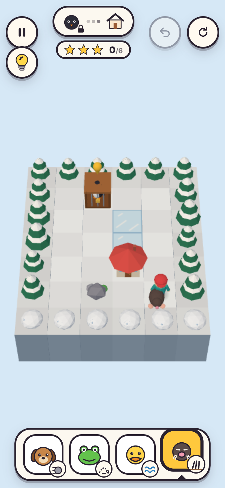
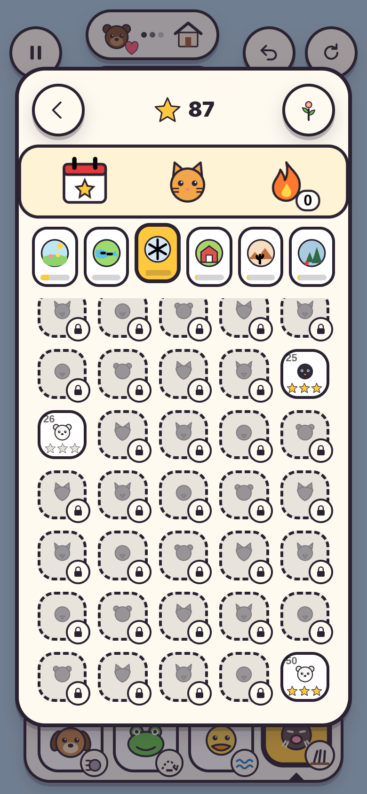
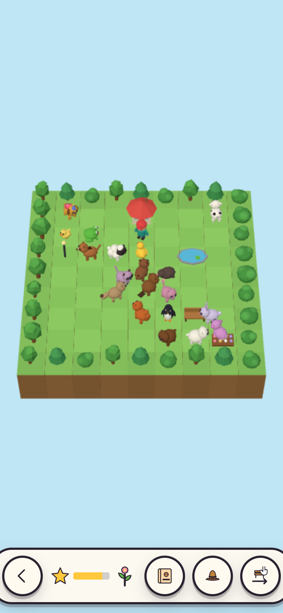
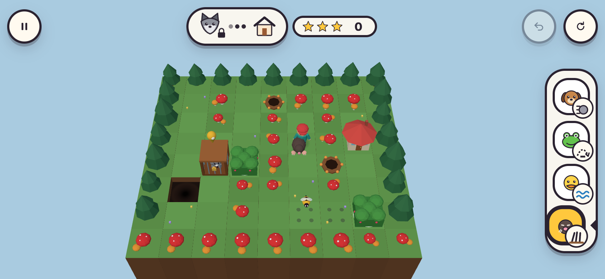

# Pet Rescue

**Pet Rescue: Borrow & Escape** is a textless, one-finger 3D puzzle game for YouTube Playables, built with three.js.

- [Game brief](docs/PET_RESCUE_BRIEF.md)
- [Textless gameplay requirements](docs/TEXTLESS_GAMEPLAY.md)
- [Engagement and ad revenue research](reports/Puzzle%20game%20engagement%20and%20ad%20revenue.md) (sources in `research_notes/`)
- [Engagement and revenue audit](docs/AUDIT_ENGAGEMENT_AND_REVENUE.md): 49 prioritized improvements and what was done about each
- [Ad policy log](docs/AD_POLICY_LOG.md) and [store listing](docs/LISTING.md)

Rescue a caged pet, then lead it home. Each rescued companion lends one ability while it leads: the puppy pushes boulders (into ponds and gaps to make crossings), the frog hops one-tile gaps, the duck swims, and the mole digs through hedges. You cannot switch companion while swimming, which drives the later puzzles.

**Status:** a complete build: 300 campaign levels in six worlds, a daily puzzle pool of more than a year, weekly sets and an endless encore, 32 animals in three looks, 16 hats, a pet garden and capped ads. It has not been uploaded, certified, tested on real phones or tested with players.

<p>
  
  
  
</p>


## Run it

```sh
npm install
npm run dev        # local development server
npm run build      # production build in dist/ plus a size report against the Playables limits
npm test           # rules, level, progress, ad-cap and translation tests (Node)
npm run smoke      # plays the production build in headless Chromium and saves screenshots/
npm run audio-preview  # renders every sound offline, checks level/clipping, writes screenshots/audio-preview.wav
node scripts/listing.mjs      # store thumbnails in four ratios into listing/ (after a build)
node scripts/level-stats.mjs  # campaign statistics used by the audit
node scripts/generate-levels.mjs  # regenerates src/levels/campaign.js (about an hour on 4 cores)
```

`dist/` is the folder to zip and upload. The browser scripts need a Chromium; they use `/opt/pw-browsers/chromium` by default or the path in `CHROMIUM_PATH`.

## Controls (one finger at a time)

| Action | Touch / mouse | Keyboard |
|---|---|---|
| Move | Tap a tile to walk there; tap an obstacle to act on it; or swipe for one step. Tap during a long slide to speed it up | Arrow keys / WASD |
| Wait (bees) | Tap the rescuer | Space |
| Choose companion | Tap its face in the bar | 1–4 |
| Hint | Light-bulb button (top left) | H |
| Undo / restart | Top-right buttons | Z or Backspace / R |
| Pause, levels, music, vibration | Top-left button | Esc or P (Esc also closes any dialog) |

## How the game stays textless

No words appear on screen; digits do (moves, stars, streak days). Words exist only for screen readers, in English, Spanish, Portuguese, French and German.

- The objective strip shows the caged pet → home. The pet gets a heart once it is rescued, and the home starts bouncing. The star meter shows moves against par.
- A bouncing pin marks the current goal. Pulsing rings mark obstacles the active companion can act on.
- A blocked move shakes the rescuer. A bubble then shows what would help: the needed companion's face (its button pulses), a lock if it is not rescued yet, or a cross.
- The first time a new element appears (currents, ice, gates, bridges, burrows, bees, or a new mix), a card shows its icon and the board rings it.
- Hints are on request. After idle time the hint button pulses; it marks the key object, then shows the next moves, then the whole route. Tutorial levels show the hand by themselves. Hints come from a solver, so they are always valid.
- If a move makes the level unwinnable, undo and restart light up and the hand points at undo.
- Rewarded-ad offers are pictures: the ad glyph → the reward, with an ad button and a cross button that look alike. Failures are picture notices.

## Retention and rewards

- **Stars** against par on every level; skipped levels can be replayed for stars.
- **Daily puzzle:** the same puzzle for everyone each UTC day, with a countdown, a four-week calendar, a streak, the best streak, and streak freezes (one earned per three dailies, up to two, used automatically). Streak hats at 3, 7, 14, 21, 30, 50 and 100 days. The result can be copied as emoji text where the clipboard is available.
- **Weekly set** of five puzzles, and an **encore** track after the campaign.
- **Win panel:** a bar to the nearest goal (decoration, hat, album set or streak hat), a preview of what comes next, and a world-complete moment at the end of each world.
- **Album:** 32 animals in six world sets, three looks each. A complete set adds a souvenir to the garden.
- **Garden:** every rescued species wanders there. Players can move decorations and try hats on pets.

## Ads

Interstitials only after a win, when the player presses Next: none in the first three levels, at most one per three levels and three minutes, none after a rewarded view or a level the player struggled with. Rewarded ads are always opt-in: skip a level, the whole-route hint, a bonus daily, choose a star hat, or a bonus friend. At most six rewarded views a day; offers hide after repeated no-fill. Every cap is in `src/ads.js` and logged in [docs/AD_POLICY_LOG.md](docs/AD_POLICY_LOG.md).

## Sound

Every sound is synthesized at runtime with the Web Audio API (`src/sound.js`, `src/music.js`), so no audio files ship.

- **Music:** a looping marimba tune over bass, a soft pad and light percussion. Each level gets its own key and a seeded melody with a repeating motif. The music follows play: it is fuller while exploring and adds a beat and echoing notes on the escape home after a rescue. It calms down after 10 seconds idle and goes muffled behind menus.
- **Animal voices:** every animal has a voice (bark, ribbit, quack, hoot, moo, neigh, crow, howl and more). They play on rescue, when switching companion, in the home celebration, in the garden, and softly when a hint or a blocked move points at a companion.
- **Effects with variation:** footsteps differ by surface, with random pitch and volume so repeats don't drone. Boulders rumble as they roll, then splash into a pond or thud into a gap. Swimming and drifting in a current splash, a collapsing bridge thuds, and a burrow jump rustles like digging.
- **Settings:** the pause menu has a music toggle. YouTube's own controls mute the game; there is no in-game master mute.

## Size and performance

- The production build is about 213 KB gzipped, against the 15 MiB initial-bundle target. All models are generated in code from primitives, and all sound and music are synthesized, so the game ships no asset files.
- Each character is merged into one vertex-coloured mesh. Ground and trees are instanced.
- The renderer caps pixel ratio at 2 and lowers it automatically if frames run slower than 45 fps.

## YouTube Playables integration

- The SDK (`https://www.youtube.com/game_api/v1`) loads first in `index.html`. `src/host.js` wraps it and falls back to the browser when the game runs outside YouTube.
- `firstFrameReady` is called after the first render. `gameReady` is called once the level is interactive. A 0×0 first viewport is handled: layout waits for a real size.
- Progress is stored with `saveData`/`loadData` (localStorage outside YouTube), after `loadData`. The score sent through `sendScore` is the total number of stars.
- `onPause`/`onResume` stop rendering, audio and every timer (hints, skip offer). Audio follows `isAudioEnabled` and `onAudioEnabledChange`.
- Vibration is optional and has a toggle in the pause menu.

## Code map

| File | Purpose |
|---|---|
| `src/logic.js` | Pure rules, tap pathfinding and a breadth-first solver (used by hints, stuck detection, tests and the generator) |
| `src/levels.js`, `src/levels/` | The campaign and daily pool (generated) and the hand-made levels |
| `src/world.js` | three.js scene, camera fitting, animation, hint routes and effects |
| `src/models.js` | Procedural low-poly models, animal looks and hats |
| `src/game.js` | Controller: input, move queue, undo, hints, win flow, daily/weekly/encore, garden, progress |
| `src/progress.js` | Save format, streaks and freezes, calendar, stars |
| `src/ads.js` | Every ad cap |
| `src/garden.js` | The pet garden |
| `src/ui.js`, `src/icons.js`, `src/style.css` | Icon-only interface |
| `src/host.js`, `src/audio.js`, `src/i18n.js` | Playables SDK, synthesized sound, screen-reader strings |
| `test/` | Rules, per-level solvability and quality, progress, ad-cap and translation tests |
| `scripts/` | Level generator, size report, level statistics, listing thumbnails, browser smoke test |
